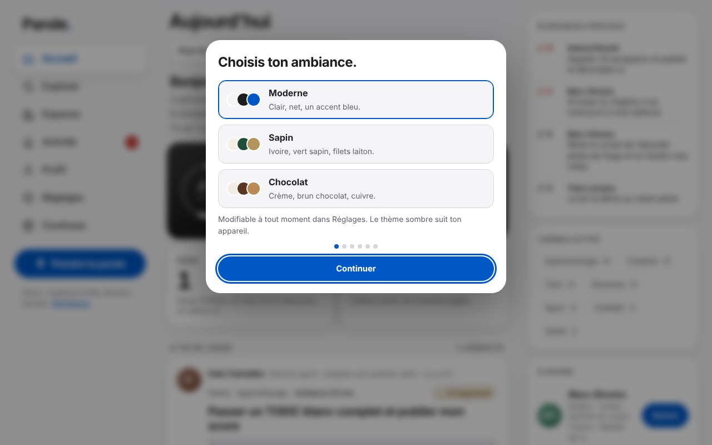

# PAROLE

Réseau social d'engagements : on ne publie pas des opinions, on donne sa parole, à voix haute, avec une échéance. Des témoins jugent, le résultat reste.

## Fonctionnalités

- Prendre la parole par dictée : un engagement daté, une échéance, jusqu'à cinq témoins et un juré tiré au sort
- Verdict à l'aveugle à l'échéance ; reports limités ; paroles privées comptabilisées sans exposer leur contenu
- Accueil, Explorer, Espaces, Activité, profil personnalisable, volet Entreprise
- Trois ambiances visuelles (Moderne, Sapin, Chocolat), modes clair et sombre
- Page de présentation : `accueil.html`

## Lancer

Ouvrir `accueil.html` pour la présentation, ou `index.html` pour le prototype.

## Fonctions connectées

La base partagée, l'identité des membres et la dictée s'activent lorsque la page est publiée comme artefact sur claude.ai, qui fournit un stockage partagé, un profil utilisateur et la reconnaissance vocale. Ouverte directement dans un navigateur, l'application bascule en mode local : le prototype fonctionne avec un jeu de démonstration enregistré dans le navigateur.

## Technique

Application monofichier en JavaScript sans dépendance (`index.html`) et page de présentation (`accueil.html`).

## Statut

Prototype fonctionnel, fonctionnalités gelées avant tests utilisateurs.

## Droits

© 2026 Florian Iglesias – Tous droits réservés. Code publié à titre de présentation : aucune licence d'utilisation, de copie ou de redistribution n'est accordée.
