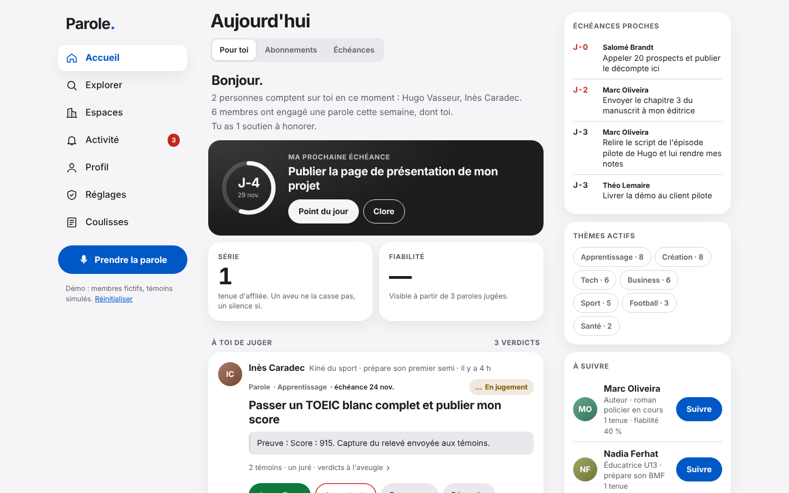

# Parole — la réputation se gagne en tenant parole

[](https://github.com/Skysaks/PAROLE/actions/workflows/ci.yml)

> **EN** — A social network made of commitments, not opinions: you give your word out loud, with a deadline; witnesses and a randomly drawn juror judge the outcome blind; the record stays. Your reputation is what you actually deliver.

**Démonstration** : [présentation](https://skysaks.github.io/PAROLE/) · [application](https://skysaks.github.io/PAROLE/parole.html) · fichiers autonomes : [`dist/accueil.html`](dist/accueil.html) et [`dist/parole.html`](dist/parole.html) (à télécharger ensemble, hors ligne). Membres fictifs, témoins simulés.



> © 2026 Florian Iglesias — Tous droits réservés. Dépôt public à titre de portfolio uniquement : aucune licence n'est concédée. Voir [LICENSE](LICENSE).

## Le principe

Les réseaux sociaux récompensent ce qu'on dit. Parole récompense ce qu'on **fait** :

1. **Prendre la parole** — un acte précis, une échéance (90 jours au plus), dicté ou écrit en dix secondes ; cinq paroles ouvertes au maximum.
2. **Témoins** — jusqu'à cinq personnes choisies, plus un **juré tiré au sort** hors du cercle de l'auteur.
3. **Verdict à l'aveugle** — à l'échéance, chacun juge sans voir le sens des verdicts déjà rendus : tenue, en partie, rompue.
4. **Le résultat reste** — série de paroles tenues, fiabilité visible à partir de trois paroles jugées.

## Fonctionnalités

- **Parades à la complaisance** : un témoin que l'auteur a lui-même confirmé compte pour ½, le juré indépendant pour 2 ; les désaveux (un témoin qui confirme ce que le juré conteste) sont comptés.
- **Aveu plutôt que silence** : abandonner ou tenir en partie ne casse pas la série ; une parole rompue ou contestée, si. Les reports sont limités.
- **Paroles privées** : comptées dans la fiabilité sans exposer leur contenu ; ce qui ne regarde que le membre (pronostic sur soi, mot à soi) reste sur son appareil.
- **Visibilité réglée par parole** : publique, abonnés ou membres d'un espace ; témoins, juré et destinataire voient toujours.
- **Accueil, Explorer, Espaces, Activité, Profil**, bilan personnel, lucidité sur soi (visible de soi seul), volet entreprise.
- **Trois ambiances** (Moderne, Sapin, Chocolat), modes clair et sombre, taille du texte et contraste réglables, lecture vocale.
- **Page de présentation** séparée, avec une politique de sécurité du contenu qui interdit toute ressource externe.

| Présentation | Application sur téléphone |
|---|---|
|  |  |

## Deux modes

| | Démonstration (ce dépôt, GitHub Pages) | Version hébergée |
|---|---|---|
| Membres | jeu fictif (Inès, Marc, Salomé…), témoins simulés | membres réels, identité fournie par l'hébergeur |
| Données | ce navigateur (`localStorage`), réinitialisables | base partagée, temps réel |
| Dictée | reconnaissance vocale du navigateur si disponible | dictée de l'hébergeur |

## Construire et tester

Node 22 (voir `.nvmrc`). Aucune dépendance d'exécution ; Playwright sert uniquement aux tests.

```bash
npm ci
npm run dev        # http://localhost:5173 (présentation) et /parole.html, reconstruits à chaque modification
npm run build      # src/ → dist/accueil.html et dist/parole.html
npm run verify     # aucune ressource externe, budget de taille, aucune donnée personnelle
npm test           # tests d'intégrité (node:test) + parcours bureau et mobile (Playwright)
npm run captures   # régénère docs/captures/
```

## Structure du dépôt

```
src/
  accueil.html, styles/accueil.css, js/accueil.js     page de présentation
  app.html                                             gabarit de l'application
  styles/                                              00-polices, 01-base … 07-mobile
  js/
    01-etat-preferences.js   limites (5 paroles, 140 caractères, 90 jours), état, ambiances, préférences
    02-utilitaires.js
    03-modele.js             règles : poids des témoins et du juré, visibilité, verdict à l'aveugle, série, fiabilité
    04-persistance.js        démonstration locale ou base de l'hébergeur
    05-lecture-vocale.js, 06-actions.js, 07-cartes.js, 08-vues.js, 09-espaces-rendu.js
  fonts/                     Libre Caslon Display (titres des ambiances Sapin et Chocolat)
dist/accueil.html, dist/parole.html                  fichiers construits, autonomes
scripts/  tests/  docs/
```

## Choix techniques

- **Les règles sont dans le modèle, pas dans l'interface** : `03-modele.js` calcule à chaque lecture qui voit quoi, ce que vaut chaque verdict et où en est la série ; les vues ne font qu'afficher.
- **Index recalculés plutôt que stockés** : contestations et désaveux sont dérivés des verdicts, ce qui évite toute incohérence entre compteurs.
- **Rendu regroupé** : les mises à jour du réseau déclenchent au plus un rendu par image (`requestAnimationFrame`).
- **Un seul fichier par page, aucune requête**, polices comprises.

## Limites connues

1. **Prototype gelé avant tests utilisateurs** : les règles (poids, seuils, délais) sont des hypothèses à éprouver.
2. **Démonstration** : membres et verdicts simulés ; aucune donnée ne quitte le navigateur.
3. **Tests automatiques sur Chromium** (bureau et mobile émulé) ; Safari et Firefox ne sont pas couverts par la CI.

## Sécurité et confidentialité

Les données personnelles de réflexion (pronostic sur soi, mot à soi) ne quittent jamais l'appareil, même en version hébergée. La page de présentation interdit toute ressource externe par sa politique de sécurité du contenu. Signalement des failles : [SECURITY.md](SECURITY.md).

## Licence

© 2026 Florian Iglesias — Tous droits réservés ([LICENSE](LICENSE)). Libre Caslon Display reste sous SIL Open Font License 1.1 ([docs/licences/](docs/licences/)). Contributions : [CONTRIBUTING.md](CONTRIBUTING.md).
